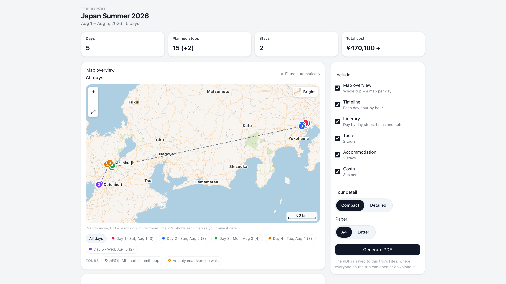

# Trek PDF

A printable trip report for TREK: route maps, a day-by-day itinerary, accommodation and a full cost breakdown in one PDF, saved straight to the trip's Files.



## What it does

Trek PDF adds a **Report** tab to every trip. The tab shows a live preview of the trip with a route map, the main numbers and the cost split by category. Pick the sections you want, choose A4 or Letter, and press **Generate PDF**.

**The preview map is interactive.** Drag to move it. Zoom with the **+** and **−** buttons, a double-click (Shift + double-click zooms out), Ctrl/⌘ + mouse wheel, or a trackpad or touch pinch; a plain mouse wheel still scrolls the page. With the keyboard, click the map, then use the arrow keys to move, **+** and **−** to zoom and **0** to fit again. The buttons under the map switch between all days, each day's own map, and each tour.

**What you frame is what you print, and it's saved.** Each map view (all days, every single day, and every tour) keeps its own zoom and position. As soon as you drag or zoom a map, that view is saved for you, and the PDF uses it: the overview shows the area you framed for all days, each day's map the area you framed for that day, and each tour's map the area you framed for that tour. Above the map you can see whether the view on screen is **Saved** or **Fitted automatically**, and **Reset** (or the fit button on the map) goes back to the automatic fit. Views you never touched fit their stops automatically, and a plain click on the map doesn't count as framing it. Saved views come back after a reload and on your other devices, and they belong to the day or tour, not to its position, so adding or moving days never puts a view on the wrong map. Each person on the trip has their own saved views.

**Tour preview.** When the trip has tours, a **Tours** card under the map shows each one as it will print: the shape of its route, when it is planned, its figures, its elevation profile and the places along it. Click a tour's route thumbnail, or its button under the map, to open the tour's own map; frame it there and the tour's map in the PDF shows the same area.

**Map style.** Press the style button in the map's top-right corner to pick from six styles, shown as small previews: OpenFreeMap's **Bright** (the default) and **Liberty** (colourful), **Positron** (light grey), **Dark** and **Fiord** (blue-grey), or the standard **OpenStreetMap** map. The style you pick is used for the preview and for every map in the PDF.

**Your choices are remembered.** The tab also keeps the map style, the sections you ticked, the tour detail and the paper size you chose, for every trip, until you change them.

The report contains:

- **Map overview.** Every planned stop on the map style you picked, coloured by day, with dashed lines showing how the trip moves from one day to the next. Each day also gets its own zoomed-in street map, so a trip that covers several cities stays readable. The OpenFreeMap styles are vector graphics: they stay sharp when you zoom or print, and a report with maps is a few hundred kilobytes. The OpenStreetMap style is made of images, so its PDFs are larger, about 2 MB.
- **Timeline.** The trip at a glance: every day is a row on an hour axis, and each stop with a time is a bar from its start to its end time. A stop without an end time runs until the next stop, for an hour at most. Stops without a time are listed under their day.
- **Itinerary.** Every day in order with its numbered stops, times, categories, addresses, place notes and day notes (with their time, when one is set). A time you set for a stop on a particular day is used before the place's general time. Notes written in Markdown (for example pasted from a planner or a chat) print as clean text: headings and table headers in bold, lists with their bullets or numbers, each table row as one line, links as their text, and no leftover `**`, `|` or `---` markers. Places you saved but haven't put on a day yet are listed at the end.
- **Tours.** Every hike, walk or other tour from TREK's Tours addon that is planned on a day, and any place with an imported GPX track. Each one gets its own route map, its distance, ascent, descent, highest and lowest point and duration, and an elevation profile. Ascent and descent are counted the way TREK counts them, so the numbers match the app. Tracks are also drawn on the overview map and on each day's map, and the itinerary shows a tour's distance and climb under its name. Each tour's map marks its start and finish and the trip's places that lie on the route (within about 200 m). The section is left out when the trip has no tours. Under **Tour detail** in the tab you choose how much each tour shows: **Compact** (a small map with the figures and profile beside it, several tours to a page) or **Detailed** (a full-width map that labels the start, the finish and the trip's places along the route, the average speed, a large profile with a height and distance grid, and the tour's notes in full).
- **Accommodation.** Each stay with check-in and check-out days and times, plus the number of nights.
- **Costs.** The total for each currency, a bar chart by category and a table of every expense. This section needs TREK's Costs addon. When the addon is off for a trip, the section is left out.

Map credits (© OpenFreeMap, OpenMapTiles and OpenStreetMap contributors) appear once in the footer of each page that has a map, instead of on every map. In the tab they sit behind a small **©** badge in the map's corner; hover over it or click it to read them.

The finished PDF is stored in the trip's Files, so everyone on the trip can open, download or print it. Its name ends with the date and time it was created, in your time zone (for example `Japan Summer 2026 - Trip report 2026-11-12 14-07.pdf`), and the PDF's cover shows the same time, so reports made on the same day are easy to tell apart. TREK shows plugins in a sandboxed frame that can't download files, so the PDF goes to Files instead of downloading straight away.

**Your language.** The tab and the PDF follow the language you chose in TREK, for all 28 of TREK's languages. Headings, dates, numbers, money and the place names on the map are all in that language. The one exception is the OpenStreetMap style: its labels are part of the map images, so they're always in each country's own language. For Arabic and Hebrew the tab is translated and laid out right-to-left, but the PDF is written in English, because its renderer can't yet lay out right-to-left text.

**Fonts.** Text in any of these scripts prints correctly: Latin (including accents), Chinese, Japanese, Korean, Thai, Cyrillic and Greek. The plugin includes the Noto Sans SC, KR and Thai fonts and puts only the characters each report needs into the PDF. Text in the PDF stays searchable and copyable.

**Privacy.** The map data comes from OpenFreeMap or, for the OpenStreetMap style, from the OpenStreetMap tile servers. Your TREK server downloads it; the browser never contacts either service. Only tile coordinates leave your server. No trip names, notes or costs are sent, and the plugin has no analytics. An admin can turn the map background off, and the maps then show routes and markers only, with no outside requests at all.

## Screenshots


## Permissions

| Permission | Why |
|---|---|
| `db:read:trips` | Reads the open trip with its days, places, assigned stops and accommodation to build the report. |
| `db:read:costs` | Reads the trip's expenses for the Costs section. The plugin never changes any of them. |
| `db:write:files` | Saves the finished PDF to the trip's Files. The user must be allowed to upload files to that trip. |
| `db:own` | Keeps each user's saved map views (how they framed the overview, each day and each tour) and their tab choices (map style, sections, tour detail, paper) in the plugin's own small database, so they come back after a reload or on another device. Nothing else is stored there. |
| `hook:user-data` | Lets TREK delete a user's saved views and choices when the user is deleted, and include them in a data export. |
| `http:outbound:tiles.openfreemap.org` | Downloads OpenFreeMap vector tiles for the Bright, Liberty, Positron, Dark and Fiord map styles, server-side. |
| `http:outbound:tile.openstreetmap.org` | Downloads standard OpenStreetMap tiles, server-side, only when the OpenStreetMap style is picked. These two map hosts are the only servers the plugin ever contacts; turn the **Map background** setting off to stop all outside requests. |

The plugin stores only each user's saved map views and tab choices (see `db:own`). Downloaded tiles are kept in memory only, and cleared when the plugin restarts.

## Setup

Install Trek PDF from **Admin → Plugins → Discover**, activate it and approve the permissions above. Then open any trip and go to the **Trek PDF** tab.

One optional instance setting, under **Admin → Plugins → Trek PDF → Instance settings**:

- **Map background** (on by default). Turn it off for maps without a background, drawn entirely by the plugin, with no outbound requests.
- **Default map style** (Bright). The style the tab starts with. Each user can still pick another one in the tab.

**Limitations.** Arabic and Hebrew get an English PDF (see above). Scripts none of the bundled fonts cover, such as Devanagari, show as empty boxes. A currency symbol the fonts can't draw, such as ₹, is written as the currency code instead (for example `INR 1,200.00`). Thai vowel and tone marks are placed without full shaping, so in rare combinations they can sit slightly off. The public OpenStreetMap tile servers are meant for light use; that's fine for occasional reports, but prefer an OpenFreeMap style for heavy use.

### Development

```bash
npm install
npm run dev     # http://localhost:4317/preview, using the sample trip in dev-fixtures.json
npm test        # route tests against the SDK's mock host
npm run shot    # store screenshot -> docs/screenshot.png (needs `npm run dev` running)
```

## License

MIT. The bundled Noto Sans SC, KR and Thai fonts (`server/fonts/`) are licensed under the SIL Open Font License 1.1; see `server/fonts/OFL.txt`. Maps: [OpenFreeMap](https://openfreemap.org) © [OpenMapTiles](https://www.openmaptiles.org); map data and the OpenStreetMap style © [OpenStreetMap](https://www.openstreetmap.org/copyright) contributors, available under the Open Database License.
