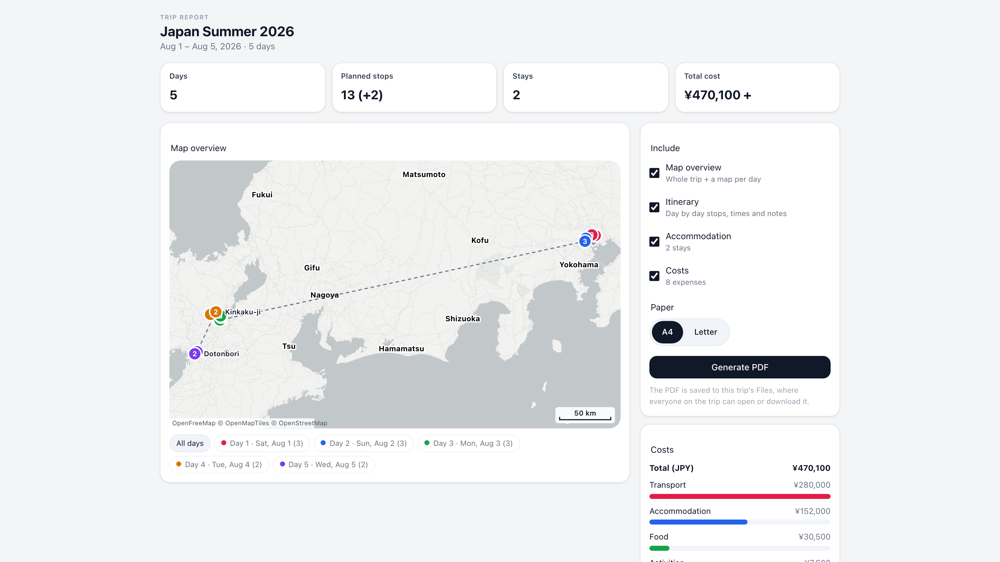

# Trek PDF

A printable trip report for TREK: route maps, a day-by-day itinerary, accommodation and a full cost breakdown in one PDF, saved straight to the trip's Files.



## What it does

Trek PDF adds a **Report** tab to every trip. The tab shows a live preview of the trip with a route map, the main numbers and the cost split by category. Pick the sections you want, choose A4 or Letter, and press **Generate PDF**.

The report contains:

- **Map overview.** Every planned stop on a clean OpenFreeMap Positron map, coloured by day, with dashed lines showing how the trip moves from one day to the next. Each day also gets its own zoomed-in street map, so a trip that covers several cities stays readable. The maps are vector graphics: they stay sharp when you zoom or print, and a report with maps is a few hundred kilobytes.
- **Itinerary.** Every day in order with its numbered stops, times, categories, addresses, place notes and day notes. Places you saved but haven't put on a day yet are listed at the end.
- **Accommodation.** Each stay with check-in and check-out days and times, plus the number of nights.
- **Costs.** The total for each currency, a bar chart by category and a table of every expense. This section needs TREK's Costs addon. When the addon is off for a trip, the section is left out.

The finished PDF is stored in the trip's Files, so everyone on the trip can open, download or print it. TREK shows plugins in a sandboxed frame that can't download files, so the PDF goes to Files instead of downloading straight away.

**Your language.** The tab and the PDF follow the language you chose in TREK, for all 28 of TREK's languages. Headings, dates, numbers, money and the place names on the map are all in that language. For Arabic and Hebrew the tab is translated and laid out right-to-left, but the PDF is written in English, because its renderer can't yet lay out right-to-left text.

**Fonts.** Text in any of these scripts prints correctly: Latin (including accents), Chinese, Japanese, Korean, Thai, Cyrillic and Greek. The plugin includes the Noto Sans SC, KR and Thai fonts and puts only the characters each report needs into the PDF. Text in the PDF stays searchable and copyable.

**Privacy.** The map data is OpenFreeMap vector tiles. Your TREK server downloads them; the browser never contacts OpenFreeMap. Only tile coordinates leave your server. No trip names, notes or costs are sent, and the plugin has no analytics. An admin can turn the map background off, and the maps then show routes and markers only, with no outside requests at all.

## Screenshots


## Permissions

| Permission | Why |
|---|---|
| `db:read:trips` | Reads the open trip with its days, places, assigned stops and accommodation to build the report. |
| `db:read:costs` | Reads the trip's expenses for the Costs section. The plugin never changes any of them. |
| `db:write:files` | Saves the finished PDF to the trip's Files. The user must be allowed to upload files to that trip. |
| `http:outbound:tiles.openfreemap.org` | Downloads OpenFreeMap vector tiles for the map backgrounds, server-side. This is the only host it ever contacts; turn the **Map background** setting off to stop it completely. |

The plugin stores nothing of its own. Downloaded tiles are kept in memory only, and cleared when the plugin restarts.

## Setup

Install Trek PDF from **Admin → Plugins → Discover**, activate it and approve the four permissions above. Then open any trip and go to the **Trek PDF** tab.

One optional instance setting, under **Admin → Plugins → Trek PDF → Instance settings**:

- **Map background (OpenFreeMap)** (on by default). Turn it off for maps without a background, drawn entirely by the plugin, with no outbound requests.

**Limitations.** Arabic and Hebrew get an English PDF (see above). Scripts none of the bundled fonts cover, such as Devanagari, show as empty boxes. A currency symbol the fonts can't draw, such as ₹, is written as the currency code instead (for example `INR 1,200.00`). Thai vowel and tone marks are placed without full shaping, so in rare combinations they can sit slightly off.

### Development

```bash
npm install
npm run dev     # http://localhost:4317/preview, using the sample trip in dev-fixtures.json
npm test        # route tests against the SDK's mock host
npm run shot    # store screenshot -> docs/screenshot.png (needs `npm run dev` running)
```

## License

MIT. The bundled Noto Sans SC, KR and Thai fonts (`server/fonts/`) are licensed under the SIL Open Font License 1.1; see `server/fonts/OFL.txt`. Maps: [OpenFreeMap](https://openfreemap.org) © [OpenMapTiles](https://www.openmaptiles.org) Data from [OpenStreetMap](https://www.openstreetmap.org/copyright) contributors, available under the Open Database License.
